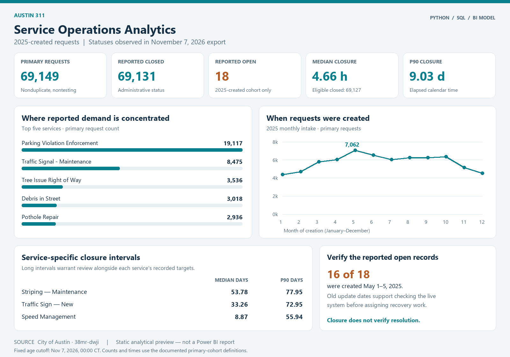

# Austin 311 Service Operations Analytics

**Python · SQL · Power BI model design · Public-service operations**

**v0.1 — Private working version.** Python/SQL analysis is validated. Power BI Desktop implementation and public portfolio release are pending.

An analysis of 2025-created Transportation and Public Works service requests: reported demand, administrative closure intervals, recorded deadlines and the reported open backlog visible in a November 7, 2026 export.



The business question is how managers can identify workload patterns and service types that deserve closer review. This project emphasizes defensible definitions, reproducibility and operational recommendations supported by the published data.

## Key results

- **73,690** gross requests created in 2025; **69,149** in the nonduplicate, nontesting primary cohort.
- **69,131** primary requests marked closed; **18** still marked open in the export.
- Median closure time **4.66 hours** and P90 **9.03 days**, among **69,127** eligible closed requests.
- **16 of 18** primary open records were created on May 1–5, 2025; all have old update dates. Verify their current status before treating them as confirmed unfinished work.
- **2** status/open-flag conflicts and **4** ambiguous creation timestamps are explicitly handled.

**Closed is an administrative status. Verified resolution is unavailable.** The snapshot closure share is 99.974%, measured after substantial follow-up. It is not a 2025 annual closure rate or a verified repair success rate. The reported backlog covers only requests created in 2025, not all departmental work.

| Primary service type | Requests | Median days | P90 days |
| --- | ---: | ---: | ---: |
| Parking Violation Enforcement | 19,117 | 0.07 | 0.50 |
| Traffic Signal - Maintenance | 8,475 | 0.04 | 4.14 |
| Tree Issue Right of Way | 3,536 | 1.05 | 14.75 |
| Debris in Street | 3,018 | 0.50 | 1.69 |
| Pothole Repair | 2,936 | 0.56 | 1.11 |
| Obstruction in Right of Way | 2,431 | 0.79 | 10.02 |

Findings and proposals: [recommendations report](reports/findings.md). Definitions and tradeoffs: [methodology](docs/methodology.md). Field-level exceptions: [quality assessment](reports/data_quality.md).

## Reproduce the analysis

Use Python 3.12. From the project root:

```powershell
python -m venv .venv
.venv\Scripts\python -m pip install -r requirements.txt
.venv\Scripts\python src/pipeline.py
.venv\Scripts\python -m unittest discover -s tests -v
```

The complete local delivery includes `data/raw/source_snapshot.csv` and its official metadata. The original source is unchanged. The pipeline runs offline, selects calendar 2025 by creation timestamp, writes a clean CSV and SQLite warehouse, exports BI tables, executes the SQL analyses and regenerates the reports and preview. The default fixed age cutoff is 2026-11-07 midnight Central Time.

**If you cloned the GitHub repository:** the large source CSV is intentionally excluded. Place the matching official export at `data/raw/source_snapshot.csv` before running the pipeline, or use the downloader below to acquire a new snapshot. Synthetic tests require only the included metadata and can run without the full export. A new live export may produce different results; use the saved source hash to identify the frozen v1 input.

For a separately acquired input:

```powershell
python src/pipeline.py --input "C:\path\to\official_export.csv" --metadata "C:\path\to\city_metadata.json" --asof 2026-11-07
```

`--asof` must follow the cohort's observed close/update/status-change timestamps. It does not reconstruct earlier states. Do not use an old cutoff with a new live export. The run manifest stores input and metadata hashes, row counts, tool versions and reconciliation results. No credentials or database server are required.

To download a **new** official snapshot into a new folder:

```powershell
python src/download_source.py --destination data/raw/refresh_2026-11-08
```

This uses the full CSV export endpoint to avoid silent API default row limits. Metadata and CSV are separate live requests; they are not an atomic transaction. New data can change historical request statuses and therefore the results. The saved v1 file is the reproducibility source, not today's portal response.

## Repository contents

| Path | Purpose |
| --- | --- |
| `src/pipeline.py` | Validation, typed cleaning, time-zone handling, warehouse and BI exports |
| `src/download_source.py` | Optional new full City export and acquisition manifest |
| `src/build_reports.py` | Evidence-driven reports and acceptance values |
| `src/render_preview.py` | Static preview built from computed tables |
| `sql/` | Explicit schema and nine analytical queries |
| `data/processed/` | Clean 2025 request CSV with source and derived fields |
| `data/warehouse/austin_311.sqlite` | Queryable SQLite warehouse with fact, dimensions and raw cohort |
| `data/powerbi/` | One fact, four dimensions and one snapshot CSV |
| `powerbi/` | Power Query, DAX, theme, relationships and dashboard plan |
| `reports/` | Computed tables, JSON evidence, narrative and static preview |
| `docs/` | Methodology, dictionaries, interview guide and review milestones |
| `tests/` | Meaningful synthetic boundary cases |

## Power BI readiness

The fact/dimension exports and [dashboard plan](powerbi/dashboard_plan.md) are ready for Desktop implementation. The package includes import queries, DAX measures, a theme, relationship instructions and expected acceptance values. **No interactive `.pbix` has been built or validated yet.** The preview above is generated directly from validated Python/SQL results. Desktop import, measure execution, filter behavior and a real dashboard screenshot remain a separate milestone.

## Analytical choices

Use Central Time for calendar-year selection and UTC for actual elapsed-time subtraction. Preserve duplicate-marked reports as demand evidence, but exclude them and testing records from primary performance summaries. Resolve two source open-flag disagreements using the explicit status and missing close dates while retaining the original fields. Exclude four ambiguous fall-hour timestamps from durations, not from volumes. Keep organizational label variants separate until a crosswalk is verified. Do not impute dates or geography.

Recommended follow-up: verify the small reported backlog in the live system; review long closure intervals within comparable service types; investigate the concentration of duplicate signal reports; and distinguish administrative closures from verified service outcomes. These are proposals, not measured operational improvements.

## Verification and publication

The build checks IDs, schema, binary flags, timestamps, foreign keys and SQLite integrity. Independently written SQL/Python median and P90 calculations reconcile, as do intake and dated closure-month totals. Eight synthetic tests pass for the v1 build. See [run evidence](reports/run_manifest.json) and [Desktop validation status](docs/desktop_validation.md).

The private repository stores source code, SQL, documentation, aggregate reports, theme and preview. Raw exports, generated row-level tables, request-level exception/backlog CSVs, the database and `.pbix` files are excluded by `.gitignore`. The full source is approximately 163 MB and exceeds GitHub's ordinary single-file limit. For exact public reproduction, arrange a versioned data-release asset and verify redistribution terms first. A fresh live download is analytically reproducible but may not reproduce the frozen snapshot's numbers. Public release remains pending the Power BI and final presentation review.

## Sources and attribution

- [City of Austin dataset — 38mr-dwji](https://data.austintexas.gov/d/38mr-dwji), with [field metadata](https://data.austintexas.gov/api/views/38mr-dwji.json).
- [Federal catalog record](https://catalog.data.gov/dataset/311-service-requests-austin-transportation-and-public-works), confirming department scope and Central Time.
- [City of Austin 311 reporting repository](https://github.com/cityofaustin/dts-311-reporting), providing publisher workflow context.
- Microsoft [star-schema](https://learn.microsoft.com/en-us/power-bi/guidance/star-schema) and [date-table](https://learn.microsoft.com/en-us/power-bi/guidance/model-date-tables) guidance for the proposed semantic model.

The public metadata does not provide a named license identifier in the captured `licenseId` field. Attribute the City and confirm the applicable portal terms before redistributing row-level records. This independent portfolio project is not an official City dashboard.
