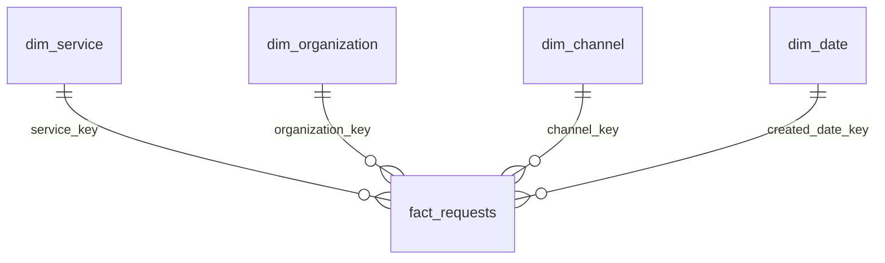

# Power BI implementation package

**Status:** fact/dimension CSVs, Power Query, DAX, theme and dashboard specification are prepared. This package is not an interactive `.pbix`. `reports/dashboard_preview.png` is a static preview built from validated results, not a Power BI screenshot. Desktop import, DAX execution and visual interactions require the checks below before claiming a finished Power BI dashboard.

## Import and relationships

1. Run the Python pipeline. Create a Power BI report and a text parameter named `pProjectFolder` pointing to the project folder.
2. Create the `LoadCsv` function from `LoadCsv.pq` and disable its load. Create the `fact_requests` query from `fact_requests.pq`. Create each dimension and snapshot query separately using the expressions in `dimensions.pq`.
3. Check that request IDs remain text, flags/keys are whole numbers, durations are decimal numbers, the date dimension has a Date type, and blanks remain null. Preserve UTC strings as text to avoid local-machine time-zone conversion.
4. Create the relationships in the table. Use one-to-many, single-direction filtering from dimension to fact. Keep `snapshot` disconnected. Turn off automatic relationship detection if it creates extra paths.
5. Mark `dim_date` as the date table using its unique `date` column. Sort `month_name` by `month`, and `year_month` by `month_sort`. Disable automatic date/time for this report.
6. Add the measures individually from `measures.dax`, import `theme.json`, and hide keys/raw flags from ordinary report authors. Retain them for the quality drill-through view.

| Dimension | Key | Fact key | Active? |
| --- | --- | --- | --- |
| dim_service | service_key | service_key | Yes |
| dim_organization | organization_key | organization_key | Yes |
| dim_channel | channel_key | channel_key | Yes |
| dim_date | date_key | created_date_key | Yes |
| dim_date | date_key | closed_date_key | No; activate only in the closure-month measure |
| dim_date | date_key | deadline_date_key | No; reserved for explicit deadline-date analysis |

The model follows Microsoft's [star-schema guidance](https://learn.microsoft.com/en-us/power-bi/guidance/star-schema) and [date-table guidance](https://learn.microsoft.com/en-us/power-bi/guidance/model-date-tables). One row in `fact_requests` is one request in the 2025-created cohort. Its primary key is `request_number`; each dimension key is unique. Keys are deterministic within this full build, not an incremental warehouse key-management system.

There is no synthetic resolution fact. `snapshot` identifies the fixed date/age cutoff and source hash. The fact table keeps duplicate/testing records so sensitivity measures can use them; primary measures enforce `in_primary = 1` without relying on a hidden report filter.

## Page 1 — Demand and closure

Use a 16:9 canvas, a restrained navy/teal palette, readable 12–14 point body labels, and a persistent scope subtitle: **Requests created in 2025 · Statuses observed in Nov 7, 2026 export**. Label the age cutoff in a tooltip.

- Top cards: Primary requests; reported closed; reported open backlog; median closure hours; P90 closure days. Keep hours/days explicit. Show duration-eligible N in the time-card tooltip.
- Left: horizontal top-ten service-volume bars. Right: monthly **creation** trend using `dim_date[year_month]` and `Primary Requests`.
- Bottom: service table with request count, eligible N, median/P90 days, closed-by-recorded-deadline share, and reported open count. Color should indicate a selected comparison, not imply that every long service time is a failure.
- Slicers: service, receiving channel, current department/group and creation month. Labels must say **creation month**. Preserve primary-measure definitions under every selection.
- Put duplicate-marked share in a demand tooltip or dedicated sensitivity panel. Its denominator is all nontesting intake and therefore differs from primary-request cards.

## Page 2 — Service-time investigation

Use a service selector and compare median/P90 closure time with sample size. Show the recorded deadline range and zero-elapsed closure count from `08_workflow_diagnostics.csv` as supporting evidence. For a live version, calculate those diagnostics from fact columns in Power Query rather than importing an aggregate disconnected from slicers.

Separate notification/administrative categories from repair-oriented comparisons based on stakeholder-verified definitions. Until that mapping is verified, display original service names and explain the workflow uncertainty. Do not silently remove fast records from the overall median.

An optional closure-month chart uses `Cohort Closures By Closure Month` and includes 2026. Its title must say **Closure month, 2025-created cohort**. The default created-date relationship must not accidentally force closure events into creation-month buckets.

## Page 3 — Reported backlog and data quality

Show the 18 primary requests still marked Open in the frozen v1 snapshot, with request number, service, creation date, last update date, recorded due date, derived age, past-deadline indicator and flag conflict. All 18 have ages above 550 days. Provide a service drill-through and a clear-empty state when a selection has no open records. Treat these as records to verify, not confirmed uncompleted repairs.

Show: 2 source open-flag conflicts; 4 ambiguous created timestamps; 378 records missing geography in gross intake; and the excluded test record. Missing close dates for the 19 open records in gross intake are expected, not evidence that all 19 are corrupt.

Do not show a historical backlog line. A map is optional and secondary; report missing coordinate coverage, use only the supplied lat/lon, and avoid ranking neighborhoods without population, exposure and reporting-access denominators.

## Desktop acceptance checks

Use the generated `reports/powerbi_acceptance.csv` as the expected-value checklist. Match counts exactly and continuous values within 0.000001 days before display rounding. Do not compare already rounded card labels.

1. With no slicers, reconcile total intake, primary, closed/open, duration-eligible N, median/P90 and deadline metrics to the generated checklist.
2. Select **TPW - Traffic Signal - Maintenance**. Check 8,475 primary requests and 1 reported open; duplicate intake should use its separate nontesting denominator.
3. Select **May 2025** in the creation-month slicer. Check 7,062 primary requests and 16 reported open. Clear the slicer and confirm the totals restore.
4. Select a service with zero open requests. Backlog detail must be empty, not display the whole cohort. Verify the clear-filter button.
5. Verify that closure-month counts reconcile to reported closed requests across both 2025 and 2026; they must match `07_closures_by_month.csv`.
6. Check `dim_date` uniqueness, no orphan keys, single-direction relationships and the disconnected snapshot. Audit that page filters do not erase the duplicate sensitivity denominator.
7. Open the four ambiguous timestamp records through the quality table. They stay in request/closed counts and have blank duration, not zero.
8. Save/reopen the `.pbix`, refresh from the project folder, repeat the total/service/month checks, and capture a real Desktop screenshot. Record Power BI version and pass/fail results in `docs/desktop_validation.md`.

The supplied DAX and M have not been executed in Power BI Desktop. Static preview totals and SQLite/Python agreement do not substitute for these application checks.
